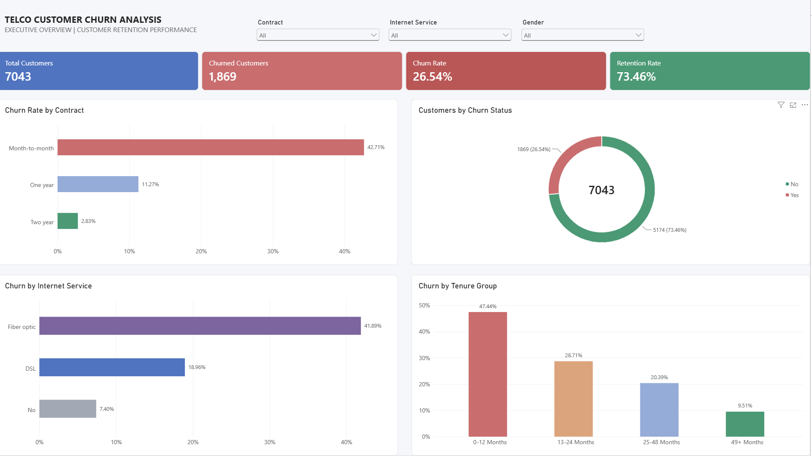
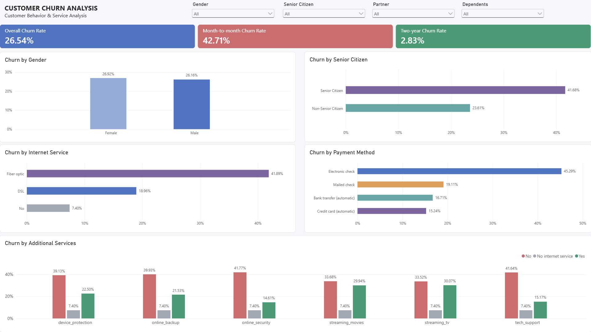
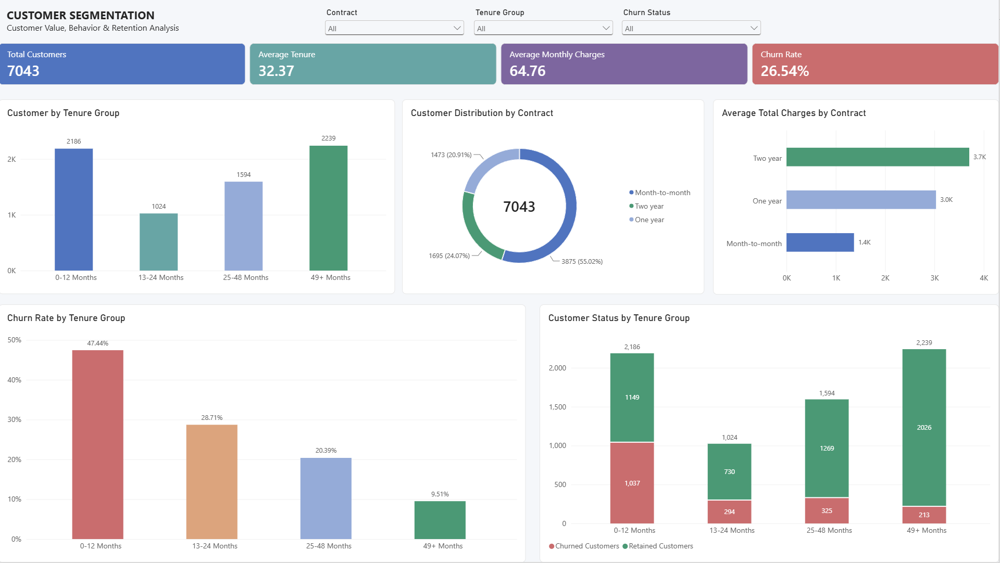

# 📊 Telco Customer Churn Analysis

An end-to-end data analytics project focused on analyzing customer churn patterns in the telecommunications industry using **Python, SQL, PostgreSQL, and Power BI**.

This project explores customer behavior, identifies customer segments with high churn rates, and translates analytical findings into actionable business recommendations to support customer retention strategies.

---

## 📌 Table of Contents

- [Project Overview](#-project-overview)
- [Business Problem](#-business-problem)
- [Project Objectives](#-project-objectives)
- [Dataset Description](#-dataset-description)
- [Tools and Technologies](#tools-and-technologies)
- [Project Workflow](#-project-workflow)
- [Data Cleaning and Preparation](#-data-cleaning-and-preparation)
- [Exploratory Data Analysis](#exploratory-data-analysis)
- [SQL Analysis](#sql-analysis)
- [Power BI Dashboard](#-power-bi-dashboard)
- [Key Business Insights](#-key-business-insights)
- [Business Recommendations](#-business-recommendations)
- [Analytical Limitations](#analytical-limitations)
- [Conclusion](#-conclusion)
- [Repository Structure](#-repository-structure)
- [How to Run This Project](#how-to-run-this-project)

---

## 📖 Project Overview

Customer churn is one of the major challenges faced by telecommunications companies. Losing existing customers can affect recurring revenue, customer relationships, and long-term business growth.

This project analyzes the **Telco Customer Churn dataset** to understand customer characteristics and identify patterns associated with customer cancellations.

The analysis covers customer demographics, subscription services, contract types, payment methods, tenure, and billing information.

Using Python for data cleaning and exploratory data analysis, PostgreSQL for SQL-based analysis, and Power BI for interactive visualization, this project provides a comprehensive view of customer churn behavior.

The final objective is to transform raw customer data into meaningful business insights and practical recommendations that can support data-driven customer retention strategies.

## 🎯 Business Problem

The telecommunications company faces a customer churn rate of 26.54%, indicating that a considerable proportion of its customer base has discontinued their subscriptions.

The business needs to understand:

- Which customer segments have the highest churn rates?
- How does contract type relate to customer churn?
- Are customers with shorter tenure more likely to leave?
- Which internet services and payment methods are associated with higher churn?
- Do additional services show different customer retention patterns?
- What retention strategies could help reduce customer churn?

Without understanding these patterns, the company may struggle to identify customers who require additional attention and develop effective retention initiatives.

## 🎯 Project Objectives

The main objectives of this project are:

1. Perform data cleaning and preparation to ensure data quality.
2. Conduct exploratory data analysis (EDA) to understand customer characteristics and distributions.
3. Use SQL to calculate key customer and churn metrics.
4. Identify customer segments with comparatively high churn rates.
5. Develop an interactive Power BI dashboard to communicate analytical findings.
6. Translate data insights into actionable business recommendations.
7. Demonstrate an end-to-end data analytics workflow using industry-relevant tools.

---

## 📂 Dataset Description

**Dataset:** Telco Customer Churn

**Source:** IBM Sample Data / Telco Customer Churn dataset, commonly distributed through Kaggle.

**File:** `WA_Fn-UseC_-Telco-Customer-Churn.csv`

The dataset contains customer information from a telecommunications company.

| Dataset Information | Details |
|---|---|
| Total Records | 7,043 |
| Total Columns | 21 |
| Unique Customers | 7,043 |
| Target Variable | Churn |
| Customer Identifier | customerID |

### Dataset Variables

The dataset contains several groups of variables:

| Category | Variables | Description |
|---|---|---|
| Customer Information | customerID, gender, SeniorCitizen, Partner, Dependents | Customer demographics and household information |
| Subscription Information | tenure, Contract, PaperlessBilling | Customer subscription characteristics |
| Internet Services | InternetService, OnlineSecurity, OnlineBackup, DeviceProtection, TechSupport, StreamingTV, StreamingMovies | Internet and additional service subscriptions |
| Phone Services | PhoneService, MultipleLines | Telephone subscription information |
| Payment Information | PaymentMethod, MonthlyCharges, TotalCharges | Payment method and billing information |
| Target Variable | Churn | Indicates whether a customer has discontinued the service |

---

<a id="tools-and-technologies"></a>
## 🛠️ Tools and Technologies

| Tool | Purpose |
|---|---|
| Python | Data cleaning, preparation, and exploratory data analysis |
| Pandas | Data manipulation and transformation |
| NumPy | Numerical operations |
| Matplotlib | Data visualization |
| Seaborn | Statistical data visualization |
| PostgreSQL | Database storage and SQL analysis |
| DBeaver | Database management and SQL query execution |
| Power BI | Interactive dashboard development |
| DAX | Business metrics and calculations |
| Power Query | Data transformation in Power BI |
| GitHub | Project documentation and version control |

---

## 🔄 Project Workflow

The project follows an end-to-end data analytics workflow:

```text
Raw Dataset
     |
     v
Data Cleaning & Preparation
     |
     v
Exploratory Data Analysis (Python)
     |
     v
Database Import (PostgreSQL)
     |
     v
SQL Analysis
     |
     v
Power BI Data Modeling
     |
     v
Interactive Dashboard
     |
     v
Business Insights
     |
     v
Strategic Recommendations
```

---

## 🧹 Data Cleaning and Preparation

Data cleaning and preparation were performed using Python and Pandas to improve data quality before conducting further analysis.

### Key Data Cleaning Steps

1. **Data Inspection**
   - Examined dataset dimensions, column names, and data types.
   - Reviewed statistical summaries and unique values.
   - Identified missing values and potential data inconsistencies.

2. **Missing Value Handling**
   - Identified 11 blank values in the `TotalCharges` column.
   - Converted the column into an appropriate numeric data type.
   - Replaced the blank values with 0 because the corresponding customers had a tenure of 0 months.

3. **Data Type Conversion**
   - Converted `TotalCharges` into a numeric data type.
   - Ensured numerical and categorical columns were represented appropriately.

4. **Duplicate Validation**
   - Checked the uniqueness of customer identifiers.
   - Confirmed that `customerID` contains 7,043 unique customer records.

5. **Data Validation**
   - Reviewed categorical values and their distributions.
   - Confirmed that `No internet service` and `No phone service` are valid categories rather than missing values.

### Data Quality Summary

| Validation | Result |
|---|---|
| Total Records | 7,043 |
| Total Columns | 21 |
| Unique Customer IDs | 7,043 |
| Blank TotalCharges | 11 |
| Blank TotalCharges After Cleaning | 0 |
| Duplicate Customer IDs | None identified |

---

<a id="exploratory-data-analysis"></a>
## 📈 Exploratory Data Analysis (EDA)

Exploratory Data Analysis was conducted using Python to understand the overall customer distribution, identify patterns, and explore relationships between customer characteristics and churn.

### EDA Areas

- Customer demographic distribution.
- Customer tenure distribution.
- Contract type distribution.
- Internet service distribution.
- Payment method distribution.
- Monthly and total charges distribution.
- Overall customer churn distribution.
- Churn patterns across customer characteristics.
- Additional service adoption and churn patterns.

### Key EDA Findings

- The overall customer churn rate is 26.54%.
- Month-to-month customers demonstrate a substantially higher churn rate than customers with longer-term contracts.
- Customers with shorter tenure show higher churn rates.
- Electronic check users have the highest churn rate among payment methods.
- Fiber optic customers have a higher churn rate than DSL customers.
- Customers without selected additional services show higher churn rates than corresponding service users.

---

<a id="sql-analysis"></a>
## 🗄️ SQL Analysis

PostgreSQL was used to store and analyze the cleaned customer dataset.

SQL queries were developed to calculate key business metrics and investigate customer churn patterns.

### Key SQL Analysis Areas

| Analysis | Description |
|---|---|
| Overall Customer Metrics | Total customers, churned customers, retained customers, and churn rate |
| Customer Tenure | Average tenure and customer distribution by tenure |
| Churn by Contract | Churn rate across contract types |
| Churn by Internet Service | Customer churn across internet service categories |
| Churn by Payment Method | Churn rate across payment methods |
| Churn by Demographics | Churn patterns by gender and senior citizen status |
| Churn by Additional Services | Relationship between service subscriptions and churn |
| Customer Billing | Monthly charges and total charges analysis |

### Overall SQL Results

| Metric | Result |
|---|---:|
| Total Customers | 7,043 |
| Churned Customers | 1,869 |
| Retained Customers | 5,174 |
| Churn Rate | 26.54% |
| Average Tenure | 32.37 Months |
| Average Monthly Charges | 64.76 |
| Average Total Charges | 2,279.73 |

The SQL results were used to validate key metrics and support the findings presented in the Power BI dashboard.

---

## 📊 Power BI Dashboard

An interactive Power BI dashboard was developed to present customer churn patterns through three analytical pages.

### Page 1 — Executive Churn Overview

Provides a high-level overview of the company's customer base and overall churn performance.

**Key Metrics:**
- Total Customers
- Churned Customers
- Churn Rate
- Retention Rate

**Visualizations:**
- Churn Rate by Contract
- Customers by Churn Status
- Churn by Internet Service
- Churn by Tenure Group

**Filters:**
- Contract
- Internet Service
- Gender



### Page 2 — Customer Churn Analysis

Examines how customer characteristics and subscription preferences relate to churn behavior.

**Key Metrics:**
- Overall Churn Rate
- Month-to-Month Churn Rate
- Two-Year Contract Churn Rate

**Visualizations:**
- Churn by Gender
- Churn by Senior Citizen
- Churn by Internet Service
- Churn by Payment Method
- Churn by Additional Services

**Filters:**
- Gender
- Senior Citizen
- Partner
- Dependents



### Page 3 — Customer Segmentation & Retention

Focuses on customer tenure, contract distribution, customer value, and retention patterns across different customer segments.

**Key Metrics:**
- Total Customers
- Average Tenure
- Average Monthly Charges
- Churn Rate

**Visualizations:**
- Customer by Tenure Group
- Customer Distribution by Contract
- Churn Rate by Tenure Group
- Average Total Charges by Contract
- Customer Status by Tenure Group

**Filters:**
- Contract
- Tenure Group
- Churn Status




---

## 💡 Key Business Insights

The analysis identified several important customer churn patterns.

### 1. Month-to-Month Contracts Have the Highest Churn Rate

| Contract Type | Churn Rate |
|---|---:|
| Month-to-Month | 42.71% |
| One Year | 11.27% |
| Two Year | 2.83% |

Month-to-month customers have approximately 3.79 times the churn rate of one-year contract customers and 15.09 times the churn rate of two-year contract customers.

Additionally, 88.55% of all churned customers belong to the month-to-month segment.

### 2. Short-Tenure Customers Are More Likely to Churn

| Tenure Group | Churn Rate |
|---|---:|
| 0–12 Months | 47.44% |
| 13–24 Months | 28.71% |
| 25–48 Months | 20.39% |
| 49+ Months | 9.51% |

Customers within their first 12 months have the highest churn rate, suggesting that the early customer lifecycle is an important retention opportunity.

### 3. Fiber Optic Customers Show Higher Churn

| Internet Service | Churn Rate |
|---|---:|
| Fiber Optic | 41.89% |
| DSL | 18.96% |
| No Internet Service | 7.40% |

Fiber optic customers have approximately 2.21 times the churn rate of DSL customers.

### 4. Electronic Check Users Have the Highest Payment-Related Churn

| Payment Method | Churn Rate |
|---|---:|
| Electronic Check | 45.29% |
| Mailed Check | 19.11% |
| Bank Transfer (Automatic) | 16.71% |
| Credit Card (Automatic) | 15.24% |

Electronic check users demonstrate the highest churn rate among the payment method categories.

### 5. Senior Citizens Have a Higher Churn Rate

| Customer Group | Churn Rate |
|---|---:|
| Senior Citizens | 41.68% |
| Non-Senior Citizens | 23.61% |

The senior citizen segment has approximately 1.77 times the churn rate of non-senior customers.

### 6. Additional Service Adoption Shows Different Churn Patterns

| Additional Service | Without Service | With Service |
|---|---:|---:|
| Online Security | 41.77% | 14.61% |
| Tech Support | 41.64% | 15.17% |
| Device Protection | 39.13% | 22.50% |
| Online Backup | 39.93% | 21.53% |

Customers subscribed to these additional services demonstrate lower churn rates than customers without the corresponding services.

These patterns indicate potential opportunities for relevant service bundling and customer engagement.

### 7. Gender Shows Only a Small Churn Difference

| Gender | Churn Rate |
|---|---:|
| Female | 26.92% |
| Male | 26.16% |

The difference is only 0.76 percentage points, making gender a lower-priority segmentation variable compared with contract type and tenure.

### 8. Long-Term Contract Customers Have Higher Accumulated Charges

| Contract Type | Average Total Charges |
|---|---:|
| Month-to-Month | Approximately 1.4K |
| One Year | Approximately 3.0K |
| Two Year | Approximately 3.7K |

Customers with two-year contracts have the highest average accumulated charges. However, Total Charges represent historical billing, not actual customer lifetime value or profitability.

---

## 🚀 Business Recommendations

Based on the findings, the following strategies are proposed to improve customer retention.

| Priority | Recommendation | Target Segment | Business Objective |
|---|---|---|---|
| High | First-Year Retention Program | Customers with 0–12 months tenure | Reduce early customer churn |
| High | Contract Upgrade Campaign | Month-to-month customers | Increase long-term contract adoption |
| High | Fiber Service Improvement | Fiber optic customers | Improve service quality and satisfaction |
| Medium | Automatic Payment Promotion | Electronic check users | Increase automatic payment adoption |
| Medium | Targeted Customer Support | Senior citizens | Improve support accessibility |
| Medium | Additional Service Bundling | Customers without additional services | Increase relevant service adoption |
| High | Customer Segmentation Strategy | Overlapping high-churn segments | Improve retention campaign targeting |

### Recommended Actions

**1. First-Year Customer Retention**
- Introduce onboarding programs.
- Conduct regular customer follow-ups.
- Provide proactive technical support.
- Offer personalized retention incentives.

**2. Contract Upgrade Campaign**
- Provide incentives for longer-term subscriptions.
- Offer discounts or additional service benefits.
- Prioritize suitable month-to-month customers.

**3. Fiber Service Improvement**
- Investigate network interruptions.
- Monitor service complaints.
- Improve technical support response times.
- Review pricing and package competitiveness.

**4. Automatic Payment Promotion**
- Encourage automatic bank transfer and credit card payments.
- Communicate payment convenience.
- Investigate potential billing issues among electronic check users.

**5. Senior Customer Support**
- Provide accessible support channels.
- Simplify billing and package explanations.
- Offer proactive assistance for recurring issues.

**6. Additional Service Bundling**
- Promote Online Security and Tech Support.
- Introduce service bundles based on customer needs.
- Monitor adoption and retention performance.

**7. Customer Segmentation**
- Identify overlapping high-churn characteristics.
- Prioritize customers requiring additional attention.
- Develop targeted retention campaigns.
- Evaluate campaign performance through measurable KPIs.

---

<a id="analytical-limitations"></a>
## ⚠️ Analytical Limitations

Several limitations should be considered when interpreting the results:

1. **Snapshot Dataset:** The dataset represents customer information at a particular point in time and does not provide a complete historical record of customer behavior.
2. **Descriptive Analysis:** The analysis identifies associations and patterns but does not establish causal relationships.
3. **Limited Churn Reasons:** The dataset does not provide comprehensive reasons explaining why individual customers discontinued their subscriptions.
4. **Limited Financial Information:** Total Charges represent accumulated billing rather than actual customer profitability or lifetime value.
5. **Segment Overlap:** Customers may belong to multiple high-churn segments simultaneously.
6. **Recommendations Require Validation:** Proposed strategies should be tested and evaluated before being treated as proven business solutions.

---

## 📝 Conclusion

The Telco Customer Churn Analysis reveals an overall churn rate of **26.54%**, indicating that customer retention is an important business challenge.

The analysis identifies several customer segments with comparatively high churn rates, particularly customers with short tenure, month-to-month contracts, electronic check payments, fiber optic services, and senior citizen demographics.

These findings provide opportunities for targeted retention initiatives, including improving the first-year customer experience, encouraging longer-term contracts, investigating fiber optic service quality, promoting automatic payments, and increasing relevant additional-service adoption.

By combining Python, SQL, and Power BI, this project demonstrates how data analytics can transform raw customer data into actionable business insights and support more informed decision-making.

---

## 📁 Repository Structure

```text
telco-customer-churn-analysis/
│
├── data/
│   ├── raw/
│   │   └── WA_Fn-UseC_-Telco-Customer-Churn.csv
│   │
│   └── processed/
│       ├── contract_churn_analysis.csv
│       ├── eda_summary.csv
│       ├── payment_churn_analysis.csv
│       ├── telco_customer_churn_cleaned.csv
│       └── tenure_churn_analysis.csv
|
├── notebooks/
│   ├── 01_data_understanding.ipynb
│   ├── 02_data_cleaning.ipynb
│   └── 03_exploraty_data_analysis.ipynb
│
├── powerbi/
│   ├── telco_customer_churn.pbix
│   │
│   └── screenshots/
│       ├── customer_churn.png
│       ├── customer_segmentation.png
│       └── executive_overview.png
|
├── reports/
│   ├── business_insights.md
│   └── recommendations.md
│
├── sql/
│   ├── 01_create_database.sql
│   ├── 02_data_validation.sql
│   ├── 03_business_analysis.sql
│   └── 04_customer_segmentation.sql
│
└── README.md
```


---

<a id="how-to-run-this-project"></a>
## ⚙️ How to Run This Project

### 1. Clone the Repository

```bash
git clone https://github.com/your-username/telco-customer-churn-analysis.git
```

### 2. Install Python Dependencies

```bash
pip install pandas numpy matplotlib seaborn jupyter
```

### 3. Run the Jupyter Notebook

```bash
jupyter notebook
```

Open the notebook located in the `notebooks/` directory and execute the analysis cells.

### 4. Import Data into PostgreSQL

- Create the PostgreSQL database.
- Create the required schema and table.
- Import the cleaned dataset.
- Execute the SQL scripts in the `sql/` directory.

### 5. Open the Power BI Dashboard

Open the `.pbix` file in Power BI Desktop.

If necessary, update the PostgreSQL connection settings to match your local database configuration.

---
